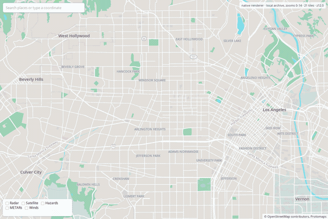

# maps-tauri

Desktop map viewer with aviation weather overlays, built with Tauri 2 and Rust. Vector tiles are
decoded and tessellated in Rust and rendered with WebGL2. Weather layers share a timeline covering
the past 18 hours and the next 12.



[Full tour (70 s, MP4)](https://github.com/jake-king/maps-tauri/releases/download/v0.1.0/maps-tauri-demo.mp4)

## Install

Ubuntu 24.04+ (amd64). The basemap and search index are separate downloads.

```sh
curl -fLO https://github.com/jake-king/maps-tauri/releases/download/v0.1.0/maps-tauri_0.1.0_amd64.deb
sudo apt install ./maps-tauri_0.1.0_amd64.deb
mkdir -p ~/.local/share/local.maps-tauri
# West LA basemap, 25 MB
curl -fL -o ~/.local/share/local.maps-tauri/westla.pmtiles \
  https://github.com/jake-king/maps-tauri/releases/download/map-westla-20261118/westla.pmtiles
# place search, 1 MB
curl -fL -o ~/.local/share/local.maps-tauri/geonames.db \
  https://github.com/jake-king/maps-tauri/releases/download/map-westla-20261118/geonames.db
maps-tauri
```

Weather is fetched from NOAA on demand. Not for flight planning. Other platforms: build from source.

## Features

- Native vector renderer, with MapLibre GL available for comparison (`MAPS_RENDERER=maplibre`)
- MRMS radar (US), GOES and global infrared satellite, METARs, GFS winds aloft by flight level,
  G-AIRMETs and international SIGMETs
- Timeline in 10-minute steps, with time-lapse playback
- Works offline: local basemap, cached weather
- Place and coordinate search (GeoNames, SQLite FTS5)

## Performance

Seeded 150-operation stress run over West LA, native renderer against MapLibre GL 6.7:

|                              | Native    | MapLibre            |
|------------------------------|-----------|---------------------|
| Frames with unrendered tiles | 0 / 2,380 | 325 / 3,066 (10.6%) |
| Render time p50 / p99        | 2 / 7 ms  | 5 / 13 ms           |
| Peak memory                  | 619 MB    | 1,501 MB            |

Methodology: `book/src/measuring.md` and `docs/JOURNAL.md`.

## How this was built

I built this in November 2026 with an AI coding agent. I set the goals, chose what to measure and
what to try next, tested the app by hand, and reviewed the changes; the agent wrote most of the
code and kept the journal. `docs/JOURNAL.md` is that working log, in the order it happened: every
problem, the measurements that turned out to be wrong, and what fixed them.

## Limitations

- One basemap area (West LA); other areas need a custom extract (see Data)
- Linux package only; macOS and Windows builds are in progress
- Place search covers West LA only

## For developers

### Build from source

Needs Rust 1.90 or newer (the gate itself runs the 1.99.1 that `rust-toolchain.toml` pins), Node,
[wasm-pack](https://rustwasm.github.io/wasm-pack/) and the Tauri 2 system dependencies for your
platform. Developed on Linux (WebKitGTK).

    npm install
    npx tauri dev                          # native renderer
    MAPS_RENDERER=maplibre npx tauri dev   # MapLibre renderer
    tools/check.sh                         # format, lint, tests, decoder and mesher checks

The benchmarks (`tools/bench.sh`, `tools/zoombench.sh`, `tools/stress.sh`) and the release-build
gates (`tools/offline.sh` for the content security policy, `tools/cache.sh` for the disk cache)
are described at the top of each script. F4 in the app opens the profiler overlay.

`tools/demo-video.sh` records the tour at the top of this page (`MAPS_DEMO=1`).

### Data

The app expects data the repository does not include (`data/` and `public/assets/` are
gitignored):

- `data/westla.pmtiles` and `data/basemap.pmtiles`: Protomaps basemap extracts (v4 schema). With
  [go-pmtiles](https://github.com/protomaps/go-pmtiles), from a daily build at
  `https://build.protomaps.com/<YYYYMMDD>.pmtiles`:

      go-pmtiles extract <build url> data/westla.pmtiles --bbox=-118.70,33.85,-118.15,34.20 --maxzoom=14
      go-pmtiles extract <build url> data/basemap.pmtiles --bbox=-118.55,33.95,-118.35,34.10 --maxzoom=14

- `public/assets/fonts` and `public/assets/sprites/v4`: from
  [protomaps/basemaps-assets](https://github.com/protomaps/basemaps-assets).
- `data/geonames.db` (optional): a GeoNames FTS5 index. The builder lives with the private Python
  service and is not included; the West LA index under Install is cut from its output. Without an
  index, search answers coordinates only.
- `data/remote.url` (optional): one line, the URL of a PMTiles archive to read over HTTP.

`tools/fetch-data.sh` does all of this from my own map service (`MAPS_SRC=<base url>`). Built from
source, the app reads `data/` in the source tree: the two downloads under Install can go there too.

### Documentation

`book/` is a short engineering book (mdBook): the architecture, the native renderer, weather, search,
how things were measured, and how they are checked. `tools/docs.sh` builds it with the Rust API
reference beside it under `api/`; every public item is documented, and the gate keeps it so.

How the weather layers fetch, decode and line up NOAA's data, and how `tools/weather.sh` checks them
end to end, is in the book's weather chapter (`book/src/weather.md`).

### What is in it

- `crates/vtile`: PMTiles v3 reading (local file, or HTTP range requests with a pluggable cache),
  Mapbox Vector Tile decoding, and meshing: polygons triangulated with earcut, lines as mitered
  strips, label positions including street names along curved paths. Its decoder output is
  checked against `@mapbox/vector-tile` over every tile of an extract.
- `crates/coords`: the search box's coordinate parser, name folding and FTS5 query builder, ported
  from the Python service and compiled to WebAssembly for the frontend. `tools/diff.py` runs the
  port and the original over about 190,000 inputs and lists every disagreement.
- `crates/wx`: NOAA weather. A GRIB2 reader for the MRMS radar mosaic and GFS model fields (a regular
  latitude/longitude grid, rows either way, values PNG-packed or simply packed, several fields to a
  file; anything else is refused by name), the reduction of a
  frame to one byte per cell for the GPU, and the G-AIRMET hazard GeoJSON.
- `src-tauri`: the backend. Tiles are served through a `tiles://` URI scheme with range support;
  meshes go to the webview in a compact binary format; `search` queries a GeoNames FTS5 index with
  rusqlite; `diskcache.rs` is the SQLite cache for the remote archive. Commands need capability
  grants, and a strict content security policy keeps the webview from reaching anything but the
  app itself.
- `src`: the frontend. `rust-renderer/` is the native renderer (the default), `maplibre-app.js`
  the MapLibre version, `devtools/` the profiler overlay and the benchmarks.

### CI

Every push and pull request runs one pipeline, the same on GitHub Actions and on the self-hosted
Forgejo forge the project is developed on (this repository is a published copy). Each job runs in a
bare Ubuntu 24.04 container through `tools/forge-job.sh`, and `tools/ci-local.sh` runs any of them
the same way on a laptop.

- `check`: `tools/check.sh`, the gate run before every commit: format, clippy, documentation,
  licences and banned dependencies (cargo-deny), unused dependencies, a secret scan (gitleaks),
  ESLint, Ruff, ShellCheck and the unit tests.
- Then, in parallel: `linux-e2e` (the release build driven end to end, below), `coverage` (fails
  under the floor in `tools/coverage-floor.txt`), `mutants` (cargo-mutants on the changed lines),
  `audit` (RustSec and npm advisories), `fuzz` (every parser's fuzz target), `perf` (instruction
  counts under Valgrind against the merge base; +3% fails) and `msrv` (builds with Rust 1.90).
- `verdict`: fails unless every job passed; it is the one check `main` requires, and merges are
  fast-forward only, so the commit CI tested is the commit on `main`.

On a schedule: advisories daily, a 10-minute fuzz of each target and a full mutation run weekly
(the missed count must not grow), and weekly `tools/update-e2e.sh`, which installs the app in a clean
container and offers it a tampered package, a package signed by another key and a replayed old
version: each must be refused and the genuine update installed.

Tauri draws with each platform's own web view: WebKitGTK on Linux, WKWebView on macOS, WebView2
(Chromium) on Windows. The renderer is WebGL2, where engines differ most, so `platforms.yml` builds
and tests on each, on demand for now: the unit tests, the release build, then the app's self-driving
end-to-end run (`MAPS_BENCH=1`) judged by `tools/e2e_check.py`. NOAA's answers come from a recorded
tape (`MAPS_TAPE_REPLAY`, `wx::tape`): every platform draws the same data, with no network, and a
request not on the tape is an error naming its URL. The tape and the map archive are a release asset
pinned by sha256 (`tools/fixtures.py`, `tools/fixtures.lock`). Speed limits apply only on the dev
box; the runners draw WebGL in software, so CI checks correctness. Each platform's snapshots are then
compared with Linux's in 8 px blocks (`tools/compare_snapshots.py`, limits in
`tools/snapshot-limits.json`). A job also builds for the iOS simulator.

A version tag runs the gate and builds the Debian package. On the forge the release also carries
SBOMs, the documentation site and SHA256SUMS, signed with the release key (`release-signing.pub`);
on GitHub it is the package alone.

Run the same end to end anywhere with `python3 tools/e2e.py --tape fixtures/tape`, and make a new
tape with `--record DIR`.

## Security

Report a vulnerability privately, as [SECURITY.md](SECURITY.md) describes: email, encrypted to the
project's key if it holds anything sensitive. Releases are signed; SECURITY.md also says how to check one.

## Licence

Code: MIT or Apache-2.0, at your option. Map data © OpenStreetMap contributors (ODbL), basemap
schema and assets by Protomaps. Place names from GeoNames (CC BY 4.0). Weather from NOAA: MRMS radar (NCEP) and G-AIRMETs
(aviationweather.gov); not for flight planning. `src/maplibre-patch.js` changes a private MapLibre 6.7.0 method and
does nothing on any other version.
