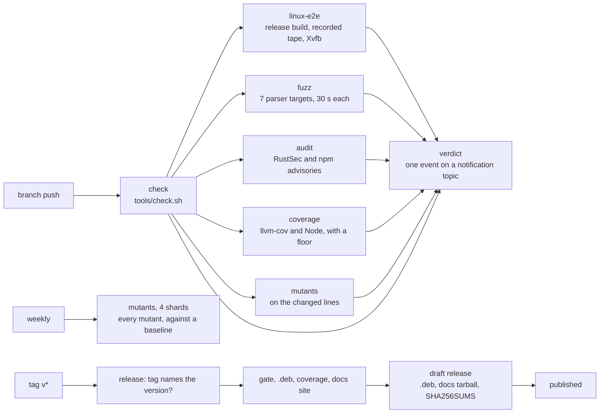

# Testing, CI and releases

## The gate

`tools/check.sh` is the one command that must pass before a commit, and CI runs the same script. Each
step runs under a time limit (and, on the dev box, a memory cap):

| step | what it holds |
|---|---|
| rustfmt, clippy | formatting; clippy with every warning an error |
| rustdoc | the API docs build with every rustdoc warning fatal |
| docs-site | this book and the API reference build, and every link in the book resolves |
| eslint, ruff, shellcheck | the JavaScript, Python tools and shell scripts |
| palette-fresh | the generated palette matches a fresh run of its generator |
| cargo-test, js-test | the Rust unit tests and doctests; the frontend's pure modules under Node |
| decoder-diff | every tile decoded by Rust and by `@mapbox/vector-tile`, compared ([The native renderer](renderer.md)) |
| mesh-westla | every tile of the larger extract meshed under a time limit, so a mesher that loops forever fails here |
| search-parity | the port against the production search service ([Search](search.md)) |

The whole-data steps skip, saying why, when their data is absent (it is not in the repository).

A check is trusted only after it has been seen to fail. Each gate step, and most test groups, were
proven by planting a defect and watching it go red; a planted defect that survives is treated as a
finding about the test. When coverage was first measured (`tools/coverage.sh`, `llvm-cov`), Rust
unit tests covered 49% of lines. The tests written to close that gap took four files to 99-100%,
caught 69 of 72 planted defects (the other three are equivalent or unreachable), and found seven real
bugs, among them a corrupt PMTiles directory that panicked a debug build and wrapped silently in
release.

### Coverage

`tools/coverage.sh` measures line coverage of the Rust unit and integration tests (source-based,
`-C instrument-coverage`, read with `llvm-cov` from the gate's own toolchain) and of the frontend's
Node tests. CI runs it on every push as its own job, and fails if either total falls below the floor
in `tools/coverage-floor.txt`, which only ever moves up. When this was written: Rust 80.6% of lines,
JavaScript 73.5%. The figure understates what is exercised: the decoder diff, the whole-archive mesh
check, search parity and the end-to-end tape are not instrumented. The files at 0% are the app's
start-up, the network fetchers, the WebAssembly bindings and the generated palette.

The [coverage report](coverage/index.html), line by line, is published with each release beside this
book.

An earlier version of the script found its test binaries by listing the build directory, which also
held binaries from older builds. `llvm-cov` then reported "mismatched data" and dropped the affected
functions: four files read 31-60% instead of 63-100%. It now takes the binaries
cargo reports for the build it just ran.

### Mutation testing

Coverage says a line ran, not that a test would notice it being wrong. `cargo-mutants` checks the
second: it makes one small deliberate bug at a time (an operator swapped, a function body replaced by
a default value, a match arm deleted), runs the tests, and lists each mutant they do not catch.
`tools/mutants.sh` runs it with the settings in `.cargo/mutants.toml`, which skip the generated
palette, the WebAssembly bindings, the app's start-up and the network fetcher, whose tests would be
the network.

The whole tree is about 2,600 mutants, hours of work, so CI splits it. Every push mutates only the
lines that push changed, in place on the warm build tree, and fails if any of those mutants survives:
new or edited code arrives with tests that would catch it breaking. A weekly workflow
(`.forgejo/workflows/mutants.yml`, or run by hand) mutates everything, in four shards one after
another because the whole is longer than the runner allows one job, and fails if more mutants are
missed than `tools/mutants-baseline.txt` records; that number only goes down.

The first full run missed 516 of 2,461 viable mutants. Most are in the mesh builder's arithmetic,
which the gate's whole-archive step runs (for hangs and panics) but no test checks, and in the app's
glue to NOAA and its debug overlay.

The first trial, on the timeline, found four surviving mutants: no test had a radar frame nearer
after its slot than before it, an exact tie between two frames, or two hazard snapshots in reach at
different distances. Two tests now pin those, and all 35 viable mutants there are caught.

### Fuzzing

Most of what the app parses comes from elsewhere: map tiles and archive directories over HTTP from a
server it does not run, GRIB2 and radar files, text and JSON from NOAA's services, and whatever is
typed in the search box. Each parser has a coverage-guided fuzz target (`fuzz/`, cargo-fuzz and
libFuzzer): the PMTiles archive read path, PMTiles directories, MVT decoding with meshing, GRIB2,
radar decompression, the weather services' text formats, and the search box. The fuzzer starts from
real inputs taken from the recorded tape and map (`tools/fuzz.sh seeds`), mutates them, and keeps
every input that reaches new code. The targets build with overflow checks on, so arithmetic that a
release build would silently wrap is a crash.

CI fuzzes each target for 30 seconds on every push, from a corpus kept between runs, and for 10
minutes each weekly, after which the corpus is minimised. A crash fails the job and prints the
input. Once fixed, the bug gets a unit test, and a small input also goes in `fuzz/regressions/`,
which every run replays.

The first hour found three real bugs, all integer overflows on values read from the input: the
archive's tile-data offset plus an entry's offset (a release build would have read from a wrapped
offset), a tile id past zoom 31 in `tile_id_to_zxy`, and coordinates near `i32::MAX` in the mesh
builder's road-shield placement. The same class was then fixed wherever else the reader added two
of the file's numbers.

The first weekly run found a hang: a fuzzed landuse polygon (a ring, a hole, and 27 one-point
holes) on which the triangulation crate, `earcutr`, never returned. A tile like that from a server
would have spun a render thread forever. The libFuzzer timeout (10 seconds an input) is what makes
a hang a finding at all. The mesher now uses the maintained `earcut` crate, which also triangulates
two polygons exactly that `earcutr` got 0.5% wrong, and is 20% faster.

The fuzzer was checked the way any check is: a bug planted in the directory parser. The archive
target missed it for ten minutes, because directories are gzipped inside the file and nearly every
mutation broke the checksum before the parser ran. A target that feeds the directory parser
directly found the same bug in eight seconds.

### Dependencies

The app is a few thousand lines of its own on 458 crates and a few hundred npm packages, so most of
the code it ships was written elsewhere. `deny.toml` says what that code may be: licenses from a
list (permissive, plus MPL-2.0, which is copyleft per file and reached through Tauri's HTML parser),
crates from crates.io only, no OpenSSL beside rustls. The gate checks it offline with `cargo-deny`.
CI's `audit` job checks the lock files against the RustSec and npm advisory databases, fetched fresh,
on every push and every day, since a new advisory concerns code nobody changed.

An advisory with no fix can be accepted, with a reason in writing: in `deny.toml` for Rust (an
unmaintained macro crate deep in the GTK bindings), in `tools/npm-audit-allow.json` for npm (a
ReDoS in a glob library only Vite's build uses). npm has no such list of its own, so
`tools/npm_audit.py` keeps one, and each entry has a date after which it fails again, so an
accepted risk gets looked at again rather than forgotten. The first run also found a KaTeX advisory
in the Mermaid that draws this book's diagrams; Mermaid 12 fixed it.

### Documentation is part of the gate

Every crate inherits the workspace's lints: rustc's `missing_docs`; clippy's `missing_errors_doc`,
`missing_panics_doc`, `doc_markdown` and `too_long_first_doc_paragraph`; rustdoc's broken-link,
bare-URL and code-block lints. So every public item is documented, every function returning a
`Result` says when it fails, and the first paragraph is a summary rustdoc's index can show. Before the
lints, 56 of 165 public items in `vtile` and 79 of 153 in `wx` were documented; now all are. Writing
the missing docs from the code found five existing docs that were wrong. Examples on key functions
(`parse_coords`, the PMTiles tile ids, the MVT geometry decoder, the radar codes) are doctests, so
they run with the unit tests and cannot drift from the code.

## End to end

The app drives itself: `MAPS_BENCH=1` runs a scripted session and reports one line of results, which
`tools/e2e_check.py` judges (plain Python, so it runs on Windows). With the weather tape replayed, the
run needs no network, and every platform draws the same data. `python3 tools/e2e.py --tape
fixtures/tape` runs it anywhere; on Linux `--xvfb` gives it a virtual display. Speed limits apply only
on the dev box; CI runners draw WebGL in software, so CI checks correctness. The tape and the map
archive used are pinned by sha256 (`tools/fixtures.lock`).

Running this in a clean Ubuntu container found a real race the dev box's speed had hidden ([Weather](weather.md)),
and a hang in `xvfb-run`'s ready signal, now avoided by starting Xvfb and waiting on its
`-displayfd` pipe.

## CI

Development happens on a self-hosted Forgejo forge, whose CI runs on every branch push: the gate,
then the Linux end-to-end leg, the coverage, mutation, audit and fuzz jobs side by side, each in a bare Ubuntu 24.04
container. The job logic lives in
`tools/forge-job.sh`, so a job runs the same way in a local container (`tools/ci-local.sh`). The
runner keeps rustup, cargo, npm's cache and the build tree between jobs, so with the cache warm the
gate takes about two minutes and the end-to-end leg about three, including the release build.

Tauri draws with each platform's own web view, and WebGL2 is where engines differ most, so the GitHub
workflows in `.github/` run the same end-to-end check on Linux, macOS and Windows and compare each
platform's snapshots with Linux's in 8 px blocks; a job also builds for the iOS simulator.

## Releases

On the forge, a version tag runs the gate, builds the Debian package and publishes it as a release
with its SHA256SUMS, and the API reference and this book with it (`tools/forge-job.sh release`). The tag must name the version in `tauri.conf.json` (`v0.1.0`; `v0.1.0-rc.1` publishes a
prerelease), and that is checked before any setup, so a wrong tag fails in seconds. The release is
created as a draft, filled, then published, so a failed upload never leaves a public release with half
its files.
