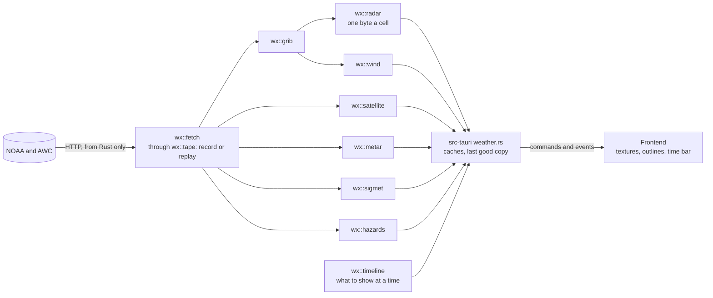

# Weather

The native renderer draws NOAA aviation weather, synced to one chosen time the way the Aviation
Weather Center's Graphical Forecasts for Aviation (GFA) does. Nothing is fetched from NOAA until a
layer's box is ticked, so the benchmarks and the offline gate stay offline. All fetching is in Rust,
so the content security policy did not change.

## Sources, decoded in Rust

Every source was fetched and read before any code was written; three design decisions came from that
rather than from assumption (show the nearest of several forecast hours, keep the last good copy when
a request fails, read only the GRIB2 templates the data actually uses).

| layer | source | decoded by |
|---|---|---|
| radar (US) | MRMS base reflectivity mosaic: GRIB2, 7000 x 3500 cells at 0.01°, PNG-packed, 0.7 MB gzipped | `wx::grib`, reduced to one byte per cell by `wx::radar` |
| satellite | GOES-East and West longwave infrared from nowCOAST, every 5 minutes; outside their view, nowCOAST's hourly global mosaic | `wx::satellite` |
| METARs | the Aviation Weather Center's bulk cache file, the world, about 5,000 stations | `wx::metar` |
| winds aloft | GFS U and V on a 0.5° grid, cut by NOAA's NOMADS filter, simply packed GRIB2 | `wx::grib`, `wx::wind` |
| SIGMETs | international SIGMETs from every FIR and US convective SIGMETs | `wx::sigmet` |
| hazards | G-AIRMET snapshots (turbulence, icing, IFR, mountain obscuration, surface wind), GeoJSON | `wx::hazards` |

The GRIB2 reader handles a regular latitude/longitude grid with rows either way, PNG or simple
packing, and several fields to a file; anything else is refused by name. A radar frame decodes and
reduces in about 0.1 s. Thinning keeps the strongest echo of each block, because averaging would
wash out a storm's core.

The global satellite mosaic uses a different grey scale from GOES. A regression over 169,000 matched
pixels (GOES = 0.650 x global + 51.4, r = 0.976) is applied on decode, so one cloud shading serves
both, and the global layer is discarded wherever GOES has data.

## Drawing

The radar is drawn in one pass over the screen: each pixel goes back through the camera to Web
Mercator, then to latitude and longitude, then to a cell index; nothing is reprojected on the CPU.
Looking right at a national zoom cannot show an error of a few cells, so `tools/weather.sh` checks
registration directly: a synthetic frame with one lit cell at a known point must light exactly the
pixels the map's own projection puts there, one cell wide and 1/cos(latitude) cells tall. An
inverted latitude and a one-cell longitude shift, planted in the shader, both fail it.

Winds are 5,000 particles moving a fixed number of screen pixels per m/s at any zoom, each keeping
its last 16 positions, so their fading trails stay put on the map through a pan, zoom or turn.

## The time bar

The bar runs from 18 hours back to 12 hours ahead in 10-minute steps. `wx::timeline` decides what
each layer shows at a chosen time:

- a radar loop slot takes the frame nearest it within 4 minutes, never one from after the chosen time;
- satellite is the newest image at or before it, no older than 30 minutes, so a stopped feed is not
  passed off as current;
- hazards are the snapshot valid nearest the chosen time, and none if that is more than 90 minutes
  away.

The backend serves any time, not just the present: what exists on NOAA's servers is refreshed in the
background, a frame or image is fetched when first needed with one fetch per key however many callers
ask, and it is kept compressed and evicted least recently used, never the present's loop. Every change
of time bumps a generation, and anything that arrives for an abandoned time is dropped before it
reaches the GPU. A clean Ubuntu container with software GL found a real race here that the dev box's
speed had hidden; a unit test with a deliberately slow fake backend now reproduces it.

Loading order matters to what a user sees. The first version showed nothing for 15 seconds, then
everything, because the frontend polled; Rust now emits an event per arrival and fetches the most
useful thing first (the newest radar frame, then the hazards, then the rest), which brought the first
frame to 1.3 s.

## The tape

`wx::tape` makes weather runs repeatable. With `MAPS_TAPE_RECORD=<dir>` every NOAA response is saved
under a key derived from its URL; with `MAPS_TAPE_REPLAY=<dir>` responses come from the tape alone and
the app's clock starts at the recorded time. Every NOAA request goes through one function, so one
change covers every layer. A request not on the tape is an error naming its URL, never a silent
fetch. This is what lets CI run the full weather checks on every platform with no network
([Testing, CI and releases](testing.md)).
